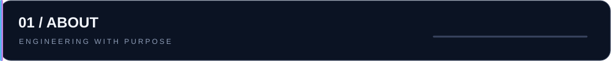
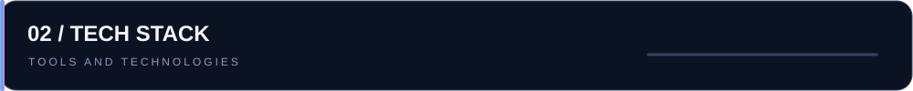

<table><tr><td width="73%" valign="top">

### Hey, I'm Abdullah 👋

I'm a **Software Architect and .NET Developer** who enjoys turning complicated business requirements into reliable, maintainable systems. I work with **ASP.NET Core, REST APIs, modular architectures, Oracle, SQL Server and enterprise integrations**.

- 🧩 **Focus:** Clean Architecture, CQRS, SOLID, modular monoliths
- 🔐 **Security:** Identity, authentication, module-level RBAC and permissions
- 🗄️ **Data:** EF Core, Dapper, ADO.NET and stored procedures
- 🚀 **Building:** Reusable .NET 10 enterprise architecture foundations
- 🌐 **Portfolio:** [abdullahdev.online](https://abdullahdev.online)

</td><td width="27%" align="center" valign="middle">

 Live GitHub profile avatar
</td></tr></table>

**Backend & API** · C# · ASP.NET Core · REST API · SignalR · Background Jobs

**Architecture** · Clean Architecture · CQRS · Modular Monolith · SOLID · RBAC

**Persistence** · SQL Server · Oracle · Entity Framework Core · Dapper · ADO.NET

<table><tr><td width="50%" valign="top">

### 🧱 UEAF — Enterprise Framework

Reusable **.NET 10 modular monolith** architecture focused on command/query execution, validation, consistent error results and extensible foundations.

**`C#` `ASP.NET Core` `CQRS` `.NET 10`**

Private development work; source code not publicly linked.

</td><td width="50%" valign="top">

### 🛡️ Access & Operational Systems

Domain-focused workflows for identity, approval management, integrations, fine-grained authorization and scalable operational services.

**`RBAC` `REST APIs` `SQL` `System Design`**

Professional experience; confidential code not shared.

</td></tr><tr><td valign="top">

### 🛍️ [MobileMart](https://github.com/abdullahnuhrio/MobileMart)

Public e-commerce project for buying and selling mobile devices, as described in its GitHub repository.

**`C#` `E-commerce`**

</td><td valign="top">

### 🧑‍💼 [Human Resource Management System](https://github.com/abdullahnuhrio/Human-Resource-Management-System)

Public HR management project covering staff-related business workflows.

**`HRMS` `Web Application`**

</td></tr></table>

Statistics depend on third-party services and may be temporarily unavailable. They are not fabricated.

### Let's connect and build great systems.

