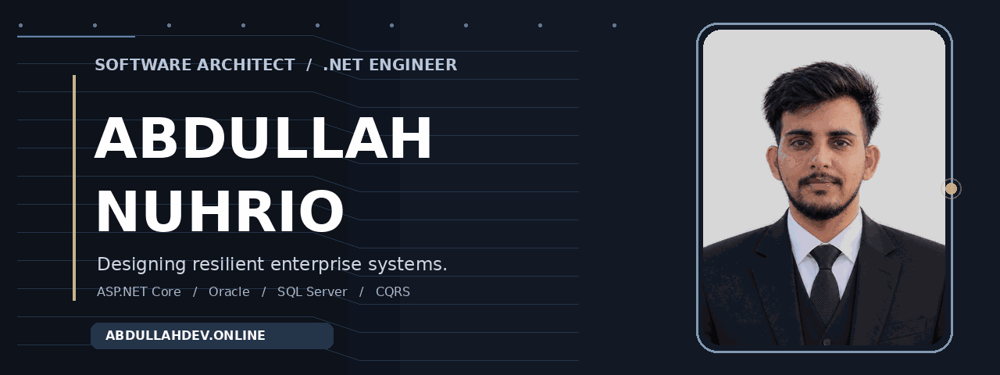

<div align="center">



<a href="https://abdullahdev.online"></a>
<a href="https://github.com/abdullahnuhrio"></a>

**SOFTWARE ARCHITECT · .NET DEVELOPER · ENTERPRISE SYSTEM DESIGN**

*I turn difficult business workflows into maintainable, secure, production-oriented software.*

</div>



### A little about me

I'm **Abdullah Nuhrio**, a software engineer focused on backend platforms and pragmatic software architecture. I work with **ASP.NET Core, C#, relational databases, API integrations, Clean Architecture, CQRS and role-based security**, with an emphasis on predictable behavior, readability and maintainability.

I enjoy untangling complex workflows: turning requirements into domain boundaries, building APIs teams can depend on, and creating foundations that remain understandable as products grow.

> My philosophy: simple where possible, rigorous where necessary, and always designed around real business needs.



| Area | Technologies & practices |
|:--|:--|
| Backend | C#, .NET, ASP.NET Core, REST API, MVC |
| Data | Oracle, SQL Server, EF Core, Dapper, ADO.NET |
| Architecture | Modular Monolith, Clean Architecture, SOLID, CQRS, MediatR |
| Authentication & access | OAuth2, OTP-based flows, role-based access control |
| Background & real-time | Hangfire, SignalR |
| Engineering | Git, GitHub, automated testing, validation, logging, error handling |



### Architecture mindset

```text
┌─────────────────────────────────────────────────────────┐
│             API / MVC / HTTP ENDPOINTS                  │
├─────────────────────────────────────────────────────────┤
│     APPLICATION  ·  CQRS  ·  VALIDATION  ·  RESULTS      │
├─────────────────────────────────────────────────────────┤
│          DOMAIN  ·  RULES  ·  ABSTRACTIONS              │
├─────────────────────────────────────────────────────────┤
│    INFRASTRUCTURE  ·  EF CORE  ·  DAPPER  ·  ORACLE      │
└─────────────────────────────────────────────────────────┘
```

**The goal isn't complexity for its own sake.** It's the right boundaries, well-defined contracts, effective observability and flexibility to evolve without breaking what already works.



### Professional experience

**EFU Life Assurance Ltd. — Backend / .NET engineering**  
Engineering work involving enterprise application workflows, Oracle-integrated backend services, business processes and API integration.

**Halcon — Software development**  
Contributed to business APIs and approval-oriented workflows, with an emphasis on maintainable service logic.

*This is a capability overview, not a claim that employer source code or private systems are publicly available.*



### Selected engineering work

**01 — Universal Enterprise Application Framework (UEAF)**  
My modular-monolith framework initiative built around **.NET 10**, CQRS, result/validation foundations, a relational-first approach, and reusable architecture conventions. **The repository is private.**

**02 — Enterprise integrations & backend workflows**  
Experience with business-process APIs, Oracle stored procedures, authorization, scheduled processing and integrations. **Employer implementations are not public.**

**03 — Personal portfolio**  
My public professional identity and showcase: **[abdullahdev.online](https://abdullahdev.online)**.

**[Browse my public repositories](https://github.com/abdullahnuhrio?tab=repositories)**



### What I enjoy building

- **Well-designed APIs:** explicit contracts, validation, reliable responses and useful error handling.
- **Identity and authorization:** role and permission models aligned with business boundaries.
- **Relational data systems:** performance-aware Oracle and SQL Server implementations.
- **Background processing:** operationally clear scheduled and asynchronous work.
- **Reusable foundations:** code that's designed to evolve, not just ship once.



### GitHub and public work

<div align="center">

<a href="https://github.com/abdullahnuhrio?tab=repositories">Browse public repositories</a> · <a href="https://github.com/abdullahnuhrio">View real contribution activity</a>

</div>

*Live third-party stat cards are intentionally omitted rather than risk broken images, fabricated statistics, or inaccurate ranking claims.*



<div align="center">

### Explore my work

[**Personal portfolio**](https://abdullahdev.online) · [**GitHub profile**](https://github.com/abdullahnuhrio) · [**Repositories**](https://github.com/abdullahnuhrio?tab=repositories)


</div>
