

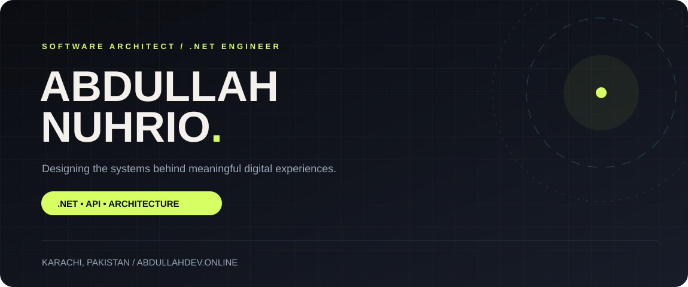

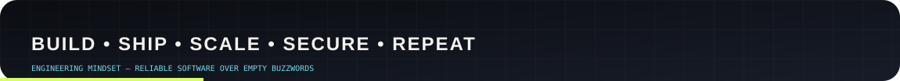

<!-- CURRENT PHOTO: Replace the preview below with your real photo as assets/portrait.jpg. Do not use old pictures or avatars. -->
<table>
<tr><td width="38%" align="center" valign="top">
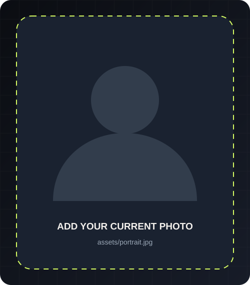
</td><td width="62%" valign="middle">

### Hello, I'm Abdullah.

**Software Architect • .NET Developer • Enterprise Systems Engineer**

I build robust software for real operational environments — with a focus on **clean boundaries, secure APIs, reliable database integrations, and maintainable codebases**.

- 📍 Karachi, Pakistan
- 🏗️ Clean Architecture · Modular Monolith · CQRS
- ⚡ ASP.NET Core · C# · REST APIs · EF Core · Dapper
- 🗄️ SQL Server · Oracle
- 🔐 RBAC · OAuth2 · OTP · secure identity workflows
- 🔗 [Explore my full portfolio](https://abdullahdev.online)

</td></tr>
</table>

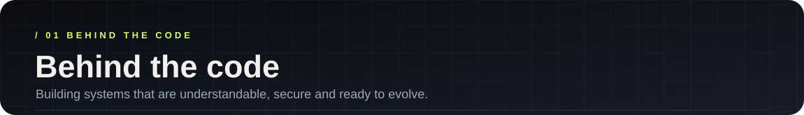

### Architecture is more than folder structure.

I enjoy turning difficult business requirements into systems that are easier to understand, operate and change. My work spans complex application workflows, Oracle and SQL Server integrations, user authorization, background processing, API contracts and modular application design.

My philosophy is practical: **solve the domain problem first, then use abstractions where they create real value**. I care about explicit validation, reliable error handling, testable application code, and clean interfaces between the business domain and infrastructure.

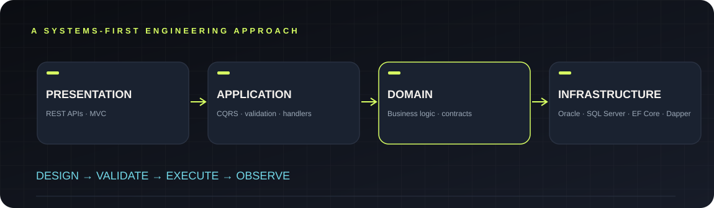

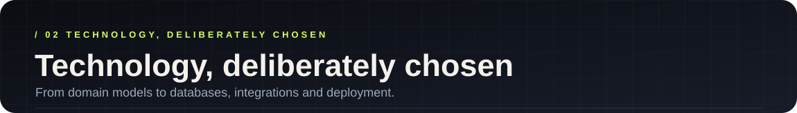

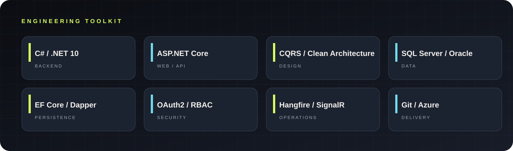

| **Backend & API** | **Data & integration** | **Architecture & engineering** |
| :-- | :-- | :-- |
| C# · .NET · ASP.NET Core · MVC · REST | Oracle · SQL Server · EF Core · Dapper · ADO.NET | CQRS · Clean Architecture · Modular Monolith |
| Background jobs · SignalR | Stored procedures · Legacy integration | SOLID · Repository · Unit of Work · Validation |
| Identity · OAuth2 · OTP · RBAC | API contracts · Third-party integrations | Testing · Dependency Injection · Observability |

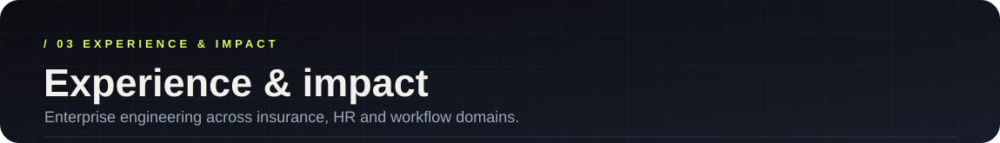

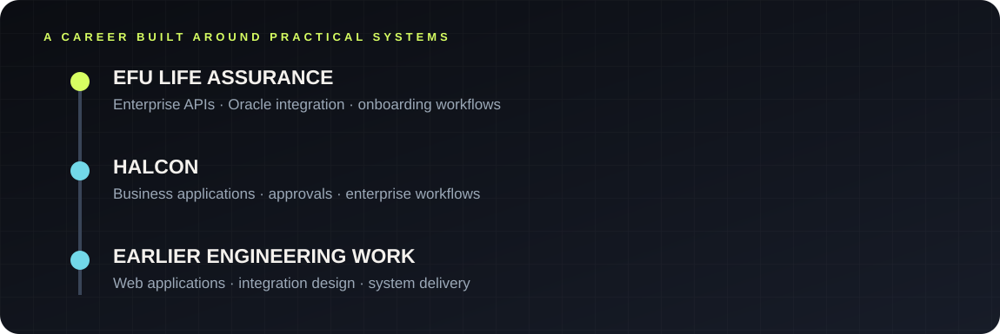

### Building for business-critical environments

**EFU Life Assurance Ltd.** — Enterprise software development with health and insurance workflows, Oracle integrations, policy processing, onboarding automation, and dependable API behavior.

**Halcon** — Business applications, departmental approval workflows, APIs, and enterprise system development.

**Engineering focus** — Enterprise modernization, secure identity, authorization boundaries, and integrations that work with existing business systems.

*Confidential employer repositories and business data are intentionally not shared here.*

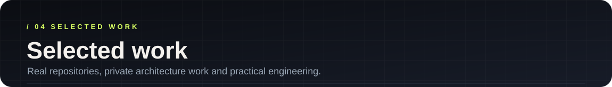

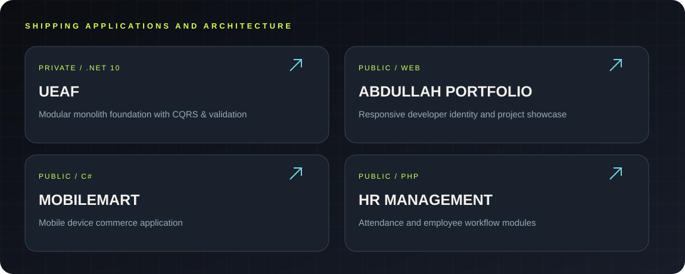

### Public projects

| Project | What it does | Source |
| :-- | :-- | :-- |
| **Abdullah Portfolio** | Personal website showcasing development work and skills | [Repository](https://github.com/abdullahnuhrio/Abdullah-Portfolio) |
| **MobileMart** | C# project for a mobile-device marketplace | [Repository](https://github.com/abdullahnuhrio/MobileMart) |
| **Human Resource Management System** | Employee and attendance-focused workflow application | [Repository](https://github.com/abdullahnuhrio/Human-Resource-Management-System) |
| **E-Commerce Website** | Online shopping application | [Repository](https://github.com/abdullahnuhrio/E-Commerce-Website) |

### Private architecture initiative · UEAF

I'm developing **Universal Enterprise Application Framework (UEAF)**: a reusable **.NET 10** modular monolith foundation with CQRS, consistent result/error contracts, validation, RBAC, and relational database support for SQL Server and Oracle. The repository is private; any showcase here describes the initiative, not a public release.

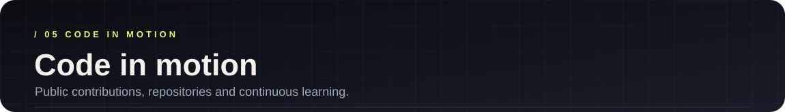

 

These external widgets may sometimes be unavailable. No activity numbers or percentages are fabricated here.

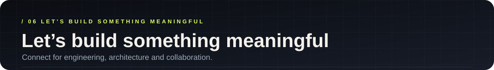

**Great systems are the result of thoughtful decisions and consistent execution.**

[**PORTFOLIO**](https://abdullahdev.online) · [**GITHUB**](https://github.com/abdullahnuhrio) · [**ALL REPOSITORIES**](https://github.com/abdullahnuhrio?tab=repositories)

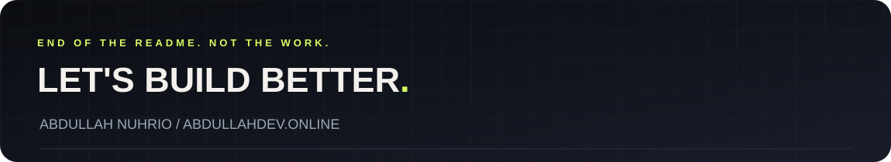

