<!-- Actual portrait image sourced from the user's public portfolio repository, NOT the GitHub avatar. -->
<table>
<tr>
<td width="42%" align="center" valign="middle">

 Actual portfolio photograph · Abdullah Nuhrio
</td>
<td width="58%" valign="middle">

### Hi, I'm Abdullah 👋

**Software Architect · .NET Developer · Enterprise Applications Engineer**

I design and build robust business applications with a focus on maintainable architecture, reliable integrations, and practical engineering decisions. My primary work revolves around **ASP.NET Core**, **RESTful APIs**, **C#**, **EF Core**, **SQL Server**, **Oracle**, and modular application design.

- 🧭 I turn complicated business requirements into understandable systems.
- 🏗️ I work with Clean Architecture, CQRS, validation pipelines and authorization.
- 🔐 I care about identity, module-level RBAC, API consistency and auditability.
- 🧩 I connect enterprise applications with legacy systems, third-party services and databases.
- 🌐 My portfolio: **[abdullahdev.online](https://abdullahdev.online)**

</td>
</tr>
</table>

I enjoy the part of software engineering where technical design meets actual operations: choosing boundaries, keeping business rules explicit, designing database access, and making systems easier to test and extend. Beyond endpoints and UI screens, I pay attention to the *whole lifecycle* of an application—from requirements and integration contracts to deployment and ongoing maintenance.

**What I optimize for:** predictable application behavior, explicit validation, consistent error handling, performance, secure permissions, maintainability, and clear separation of concerns.

> "Good architecture doesn't make simple things complicated. It makes complicated things manageable."

### Core engineering

    

### Persistence & databases

    

### Architecture, delivery & integration

`Clean Architecture` · `Modular Monolith` · `CQRS` · `Repository / Unit of Work` · `RBAC` · `OAuth2 / OTP` · `Background Jobs` · `SignalR` · `Third-party API integrations` · `Git` · `CI/CD`

### Front-end and supporting technologies

`HTML` · `CSS` · `JavaScript` · `Bootstrap` · `Angular` · `TypeScript`

### Enterprise software engineering

| Focus area | Engineering contributions |
| :--- | :--- |
| **Insurance & health systems** | API integrations, Oracle database operations, policy workflows, onboarding/reminder automation and service reliability. |
| **Access control & workflow systems** | RFID/QR-based access, approvals, multi-zone workflows, device integration patterns, invoice and identity flows. |
| **Enterprise application foundations** | CQRS, reusable validation, error/result contracts, DI, automated tests, architecture boundaries and modular design. |
| **Legacy modernization** | Integration with older databases and business applications while moving functionality into maintainable APIs. |

These describe professional technical work, not necessarily open-source repositories. Specific employer code and private enterprise systems are intentionally not published here.

### Engineering approach

1. **Discover the domain** — clarify business rules, edge cases and integration contracts.
2. **Choose clear boundaries** — isolate application, domain, infrastructure and presentation concerns.
3. **Deliver with confidence** — validation, meaningful errors, tests and observability.
4. **Design for the next change** — build only useful abstractions and keep dependencies explicit.

### Featured public repositories

<table>
<tr>
<td width="50%" valign="top">

**[Abdullah Portfolio](https://github.com/abdullahnuhrio/Abdullah-Portfolio)**

My personal portfolio, using HTML, CSS and JavaScript, with responsive layouts and visual interactions.

`HTML` `CSS` `JavaScript` `Responsive UI`

[Explore source →](https://github.com/abdullahnuhrio/Abdullah-Portfolio)

</td>
<td width="50%" valign="top">

**[MobileMart](https://github.com/abdullahnuhrio/MobileMart)**

A mobile-device marketplace project featuring a customer-facing commerce workflow.

`C#` `E-commerce` `Application Development`

[Explore source →](https://github.com/abdullahnuhrio/MobileMart)

</td>
</tr>
<tr>
<td width="50%" valign="top">

**[Human Resource Management System](https://github.com/abdullahnuhrio/Human-Resource-Management-System)**

A system covering essential HR functions such as employee-related workflows and attendance management.

`HRMS` `Business Workflows` `PHP`

[Explore source →](https://github.com/abdullahnuhrio/Human-Resource-Management-System)

</td>
<td width="50%" valign="top">

**[E-Commerce Website](https://github.com/abdullahnuhrio/E-Commerce-Website)**

A commerce application for browsing items and supporting online shopping use cases.

`PHP` `E-commerce` `Web Development`

[Explore source →](https://github.com/abdullahnuhrio/E-Commerce-Website)

</td>
</tr>
</table>

### Architectural work in progress

**UEAF · Universal Enterprise Architecture Framework** — A private reusable .NET 10 enterprise foundation emphasizing modular application structure, consistent API contracts, CQRS handlers, validation, and SQL Server/Oracle support. **Private project; no public repository link.**

Contribution visualization is sourced from a third-party service and may occasionally be unavailable or incomplete.

### See the code behind the work

[**Browse all public repositories →**](https://github.com/abdullahnuhrio?tab=repositories)

*No artificial streak counts, fake contribution statistics, or invented achievements are displayed.*

**Let's talk architecture, scalable back-end systems, and meaningful software.**

